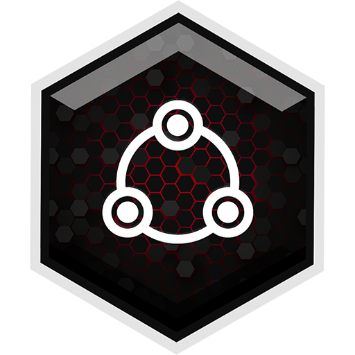
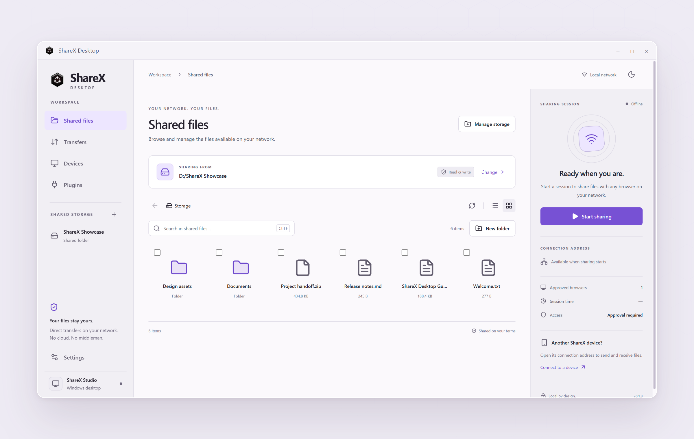

<p align="center"></p>
<h1 align="center">ShareX Desktop</h1>
<p align="center">Local file sharing between your desktop, phone, and browser.</p>
<p align="center"><a href="https://github.com/akanshSirohi/ShareX-Desktop/releases">Downloads</a> · <a href="docs/building.md">Build from source</a> · <a href="https://github.com/akanshSirohi/ShareX">Android app</a> · <a href="CONTRIBUTING.md">Contribute</a></p>



ShareX Desktop brings the [ShareX Android](https://github.com/akanshSirohi/ShareX) workflow to the desktop with **Tauri 2, Rust, React, and TypeScript**. Files move directly over your local network; receiving devices connect through a browser. The original ShareX logo and browser portal are retained.

## Features

- **Choose what to share:** a folder, a drive, all eligible Windows drives, or selected files.
- **Control access:** browser approval, remembered browsers, revocation, optional passwords, and session expiry.
- **Manage files:** browse, search, preview, upload, download, create folders, rename, copy, move, and delete within the shared root.
- **Follow transfers:** history, byte progress, average speeds, and sent/received totals.
- **Connect devices:** QR codes, QR image import, camera scanning, and HTTP/HTTPS connection controls.
- **Extend the portal:** install plugins from the store or ZIP files, approve plugin access, and use plugin messaging and storage.
- **Make it yours:** dark/light appearance, seven portal themes, keyboard search, and tray controls.

Read-only access is enabled by default. Windows BitLocker protected drives and drives with unknown protection status are excluded.

## Download and platform status

Download installers from **[the latest release](https://github.com/akanshSirohi/ShareX-Desktop/releases/latest)**. Expand **Assets** and choose the package for your system. Releases publish automatically after all platform builds succeed.

| Platform | Status | Download |
| --- | --- | --- |
| Windows 10/11 x64 | Primary platform; native builds and local sharing tested | `windows_x64-setup.exe` installer |
| macOS Apple Silicon | Experimental | `darwin_aarch64.dmg` |
| macOS Intel | Experimental | `darwin_x64.dmg` |
| Linux x64 | Experimental | `linux_amd64.AppImage` or `linux_amd64.deb` |

Asset names also include the application version. Install the Windows executable, drag the macOS app from the DMG into Applications, or follow the [Linux installation steps](docs/building.md#install-a-release). The macOS application archive is also included. GitHub's **Source code** archives contain source, not installers.

Packages are currently unsigned; macOS packages are not notarized. See [installation and platform details](docs/building.md#install-a-release). If no release is available yet, the first merge enabling the release workflow must finish, or you can build from source below.

macOS and Linux have not been validated on native hardware. Windows volume discovery and BitLocker checks are platform-specific. Use a single folder when testing on macOS or Linux; mounted-volume enumeration and FileVault/LUKS checks are not implemented.

## Start sharing

1. Open **Manage storage**, choose your shared root, and save.
2. Select **Start sharing**.
3. Open the displayed address or scan the QR code from a device on the same Wi-Fi or hotspot.
4. Approve the browser in the popup or on **Devices**. An optional sharing password also grants browser access.
5. Stop sharing when finished. While sharing, closing the window keeps the app in the tray; use **Quit** in the tray menu to exit.

To connect to another ShareX device, choose **Connect to a device** and enter its protocol, IP address, and port. The other device must be running its sharing server. Plugins require a separate approval after browser access.

Local transfers do not require internet access. Online features such as the plugin store do. Allow incoming connections on your trusted local network when your operating system asks.

## Build from source

Install Node.js 24+, stable Rust, and your operating system's [Tauri prerequisites](https://v2.tauri.app/start/prerequisites/), then:

```sh
git clone https://github.com/akanshSirohi/ShareX-Desktop.git
cd ShareX-Desktop
npm ci
npm run tauri dev
```

Create a native release build with `npm run tauri build`. See the [Windows, macOS, and Linux build guide](docs/building.md) for system packages, output locations, universal macOS builds, and portal development.

## Documentation

- [Build and packaging](docs/building.md)
- [Architecture](docs/architecture.md)
- [Development and testing](docs/development.md)
- [Known limits](docs/limitations.md)
- [Automatic releases](docs/releases.md)
- [Screenshots](screenshots/README.md)
- [Contributing](CONTRIBUTING.md)
- [Security reporting](SECURITY.md)
- [Changelog](CHANGELOG.md)

## Android project and attribution

The Android application is developed in **[akanshSirohi/ShareX](https://github.com/akanshSirohi/ShareX)**. Android builds belong in that repository; this repository contains the desktop host and its adapted browser portal.

ShareX was created by **Akansh Sirohi and contributors**. This edition adds the desktop interface, Rust sharing server, Windows storage integration, and native packaging. See [NOTICE](NOTICE.md) and [third-party notices](THIRD_PARTY_NOTICES.md).

## License

**ShareX Desktop is free software licensed under the GNU Affero General Public License, version 3 or later (AGPL-3.0-or-later).**

```text
Copyright © 2022 Akansh Sirohi (original ShareX project)
Copyright © 2026 ShareX Desktop contributors (desktop modifications)

This program is free software: you can redistribute it and/or modify
it under the terms of the GNU Affero General Public License as published
by the Free Software Foundation, either version 3 of the License, or
(at your option) any later version.

This program is distributed in the hope that it will be useful,
but WITHOUT ANY WARRANTY; without even the implied warranty of
MERCHANTABILITY or FITNESS FOR A PARTICULAR PURPOSE. See the
GNU Affero General Public License for more details.
```

When redistributing ShareX Desktop or a modified version:

- Keep the covered software under the AGPL and preserve its copyright, license, attribution, and warranty notices. Include a copy of the license.
- Provide recipients with the complete corresponding source for the version you distribute, including your modifications and the scripts needed to build and install it, as required by the license.
- Clearly identify modified files and the dates of your changes.
- If you modify the software and let users interact with it over a network, prominently offer those users the corresponding source at no charge, as required by AGPL section 13.

**You may not redistribute covered code as a closed-source proprietary application.** Commercial use and charging for copies are allowed when you comply with the AGPL; publishing through an app store does not remove these obligations. Private use alone does not require publishing your changes.

Read the full [GNU Affero General Public License](LICENSE) for the governing terms. See [NOTICE](NOTICE.md) for original-project attribution and [third-party notices](THIRD_PARTY_NOTICES.md) for components with their own licenses. This project is separate from the unrelated Windows screenshot utility also named ShareX.
